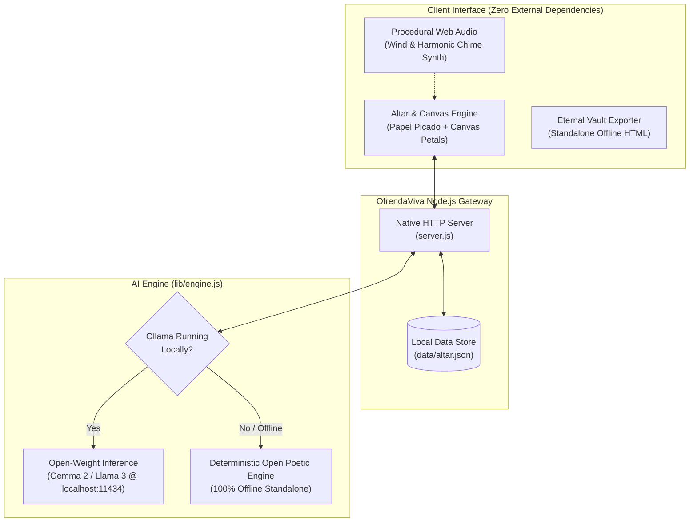

# 🕯️ OfrendaViva 🌼
### *A Sacred, Local-First Día de los Muertos Altar & Ghost in the Machine Séance powered by Open-Weight AI*

[](https://dev.to/challenges/hacktoberfest-week4-2026-10-26)
[](https://dev.to/challenges/hacktoberfest-week4-2026-10-26)
[](LICENSE)
[-success.svg)](#quickstart)
[](#open-weights--gemma-integration)

---

## 💀 Overview

**OfrendaViva** is an offline-first, private digital memorial altar and interactive séance chamber built for the **Hacktoberfest Open-Source AI Challenge Week 4: Ghost in the Machine**.

As the veil between worlds thins during Halloween (October 31) and Día de los Muertos (November 1–2), OfrendaViva bridges cultural reverence with open-source artificial intelligence. It honors computing ancestors (such as **Ada Lovelace**, **Alan Turing**, **Grace Hopper**, and **Margaret Hamilton**) and personal loved ones through interactive altar offerings, synthesized *Calaveritas Literarias* (traditional Mexican rhyming skull poetry), and atmospheric terminal séances.

Most importantly, OfrendaViva runs **100% locally on your machine with open-weight models (Gemma 2 / Llama 3 via Ollama)** or its built-in offline literary engine—ensuring that the sacred memories, photos, and grief of your family are never monetized, tracked, or held hostage by closed commercial clouds.

---

## ✨ Key Features

1. **🕯️ 3-Tier Traditional Interactive Altar (*El Altar de Recuerdos*)**:
   - **Nivel I (El Cielo)**: Portraits and spirits of pioneers and ancestors with interactive candle flames (click to light or blow out).
   - **Nivel II (La Tierra)**: Sacred elements—fragrant *Cempasúchil* (marigolds), *Pan de Muerto*, sweet copal incense, water, and salt.
   - **Nivel III (El Inframundo)**: Decorated sugar skulls (*calaveritas de azúcar*) and personal mementos.

2. **📜 Open-Weight Calaverita & Epitaph Synthesis**:
   - Generates authentic rhyming *Calaveritas Literarias* celebrating life with gentle humor and love.
   - Generates timeless, sacred altar memorial epitaphs.
   - Powered locally by **Google Gemma 2** or **Llama 3** via Ollama, with instant fallback to a deterministic, high-fidelity built-in poetic engine when offline.

3. **👻 Midnight Ghost in the Machine Séance Mode**:
   - Switch with one click from warm candlelit Día de los Muertos into a spectral, eerie midnight séance chamber with ghostly turquoise wisps and spirit communion.
   - Commune with historical computing ghosts: ask Ada Lovelace about algorithmic poetry, Alan Turing about the imitation game, or Grace Hopper about compiler bugs.

4. **🎶 Procedural Ambient Web Audio Synthesizer**:
   - Synthesizes atmospheric cemetery wind breeze and ethereal harmonic resonant singing chimes using the native browser **Web Audio API** (100% pure procedural audio math—zero audio files downloaded or tracked).

5. **💾 1-Click Eternal Vault Export**:
   - Export your entire altar and its tributes as a standalone, zero-dependency, self-contained `.html` file. Save it on a USB flash drive or local home server—guaranteed to open in any web browser 50 years from now without any server or internet connection.

6. **💻 GhostShell CLI Companion**:
   - Run `npm run ghost` in your terminal to experience an ASCII terminal séance, scan your Git commit history for "ghost commits", and compose verse straight from the command line.

---

## 🏛️ System Architecture



---

## 🌼 Why Open Innovation Matters

In hackathons and tech discourse, AI is often conflated with commercial cloud APIs. But an ofrenda is not a chat tool—it is an intimate altar for the dead. **Open innovation is the only ethical foundation for this project:**

- **Sacred Privacy**: Photos of lost grandparents, heartfelt confessions, and private mourning notes must never be uploaded to remote cloud datacenters, logged, or used as training fodder for closed models.
- **Eternal Preservation & Anti-Vendor Lock-in**: Commercial startups pivot, change pricing tiers, or shut down entirely. If a memory platform relies on a closed API, your altar dies when the company does. Open-weight models (like **Gemma 2**) can run on consumer laptops completely disconnected from the internet forever.
- **Authentic Expression Beyond Corporate Censorship**: Commercial safety filters often sanitize or refuse honest conversations about grief, death, and mortality with sterile disclaimers. Open-weight models empower builders to cultivate respectful, culturally authentic folk traditions without gatekeepers.

---

## 🚀 Quickstart

OfrendaViva uses pure Node.js standard libraries—**no `npm install` required to run!**

### 1. Clone & Run
```bash
git clone https://github.com/sindhelohitaksh/OfrendaViva.git
cd OfrendaViva

# Start the web altar
node server.js
```
Open **[http://localhost:3000](http://localhost:3000)** in your browser.

### 2. Optional: Enable Open-Weight Gemma 2 (Local LLM)
If you have [Ollama](https://ollama.ai) installed:
```bash
ollama run gemma2:2b
```
OfrendaViva will automatically detect the local model and route inference locally! If Ollama is not installed or offline, OfrendaViva automatically uses its built-in offline poetic synthesis engine with zero errors.

### 3. Run the Haunted GhostShell CLI
```bash
node bin/ghost-shell.js
# or
npm run ghost
```

### 4. Run Test Suite
```bash
node test/test-engine.js
```

---

## ☁️ Deployment (Render)

OfrendaViva includes a [`render.yaml`](render.yaml) blueprint for 1-click deployment to **Render** as a free web service:
1. Fork or push this repository to GitHub.
2. In Render, select **New Blueprint** and connect this repository.
3. Render will automatically configure and deploy the service.

---

## 📜 Partner Categories Entered

- **Best Use of Gemma**: Seamless integration with Google's open-weight Gemma 2 family (`gemma2:2b` / `gemma2:9b`) via local Ollama inference, providing sacred, offline-first generation of *Calaveritas Literarias* and historical séances.
- **Best Use of Render**: Includes `render.yaml` blueprint with zero-dependency Node.js configuration for instant, zero-cost cloud preview.

---

## 📄 License

This project is licensed under the [MIT License](LICENSE). Built for **Hacktoberfest 2026: Week 4 (Ghost in the Machine)** by **[Lohitaksh Sindhe](https://dev.to/premsai5142)**.
